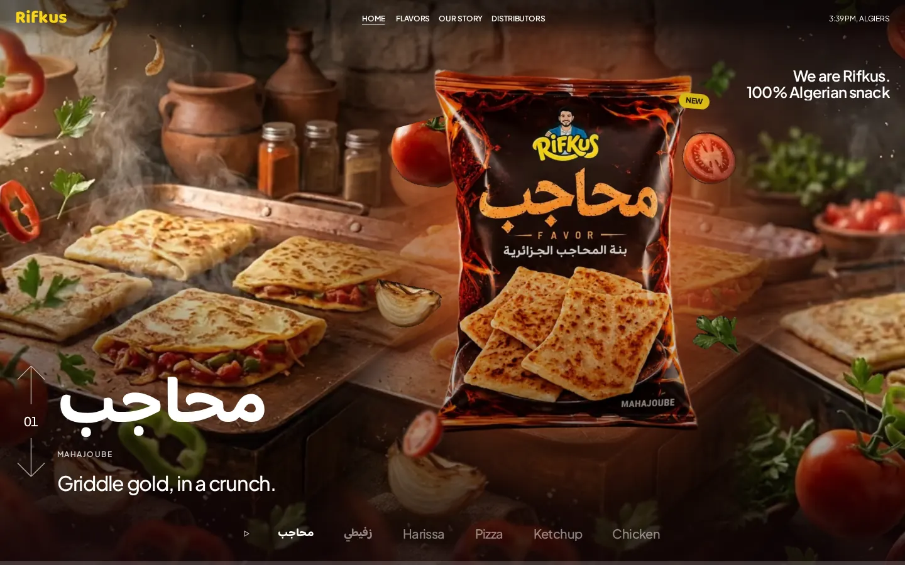
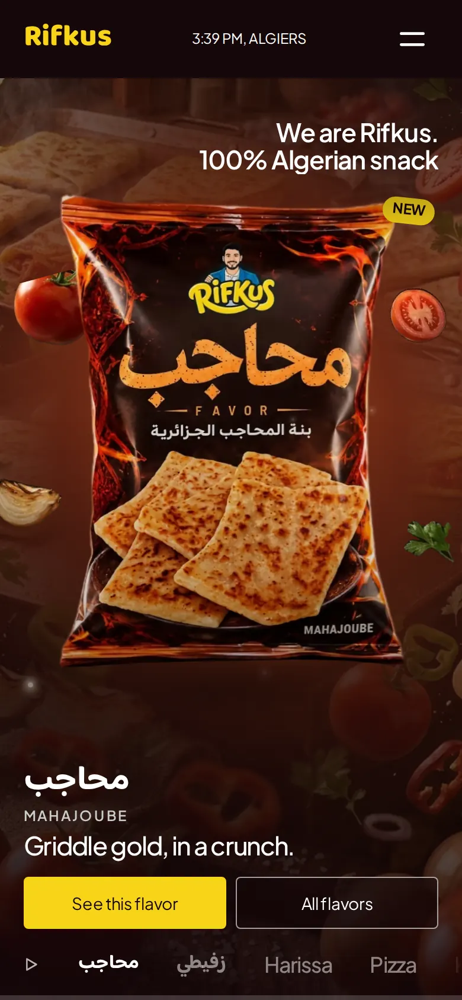
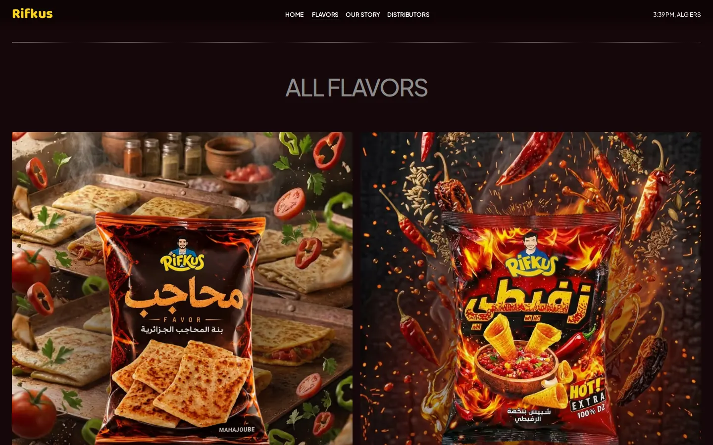
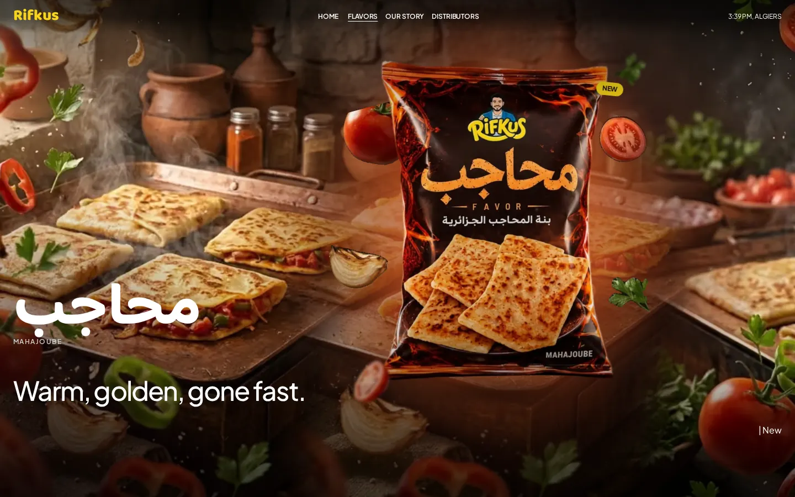
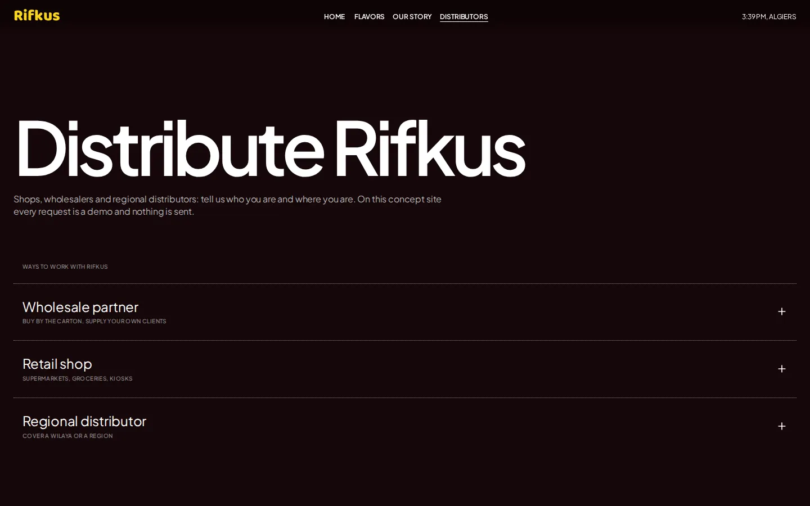

# Rifkus: concept website

[](https://github.com/anevioweb-cell/rifkus-concept-site/actions/workflows/ci.yml)

A frontend-only concept website for the Algerian snack brand Rifkus. It features a full-screen hero slider with layered flavor scenes, flavor pages, a story page and a distributor page. Built with React, Vite and Tailwind CSS, and prerendered at build time.

> **Unofficial concept.** This project is not made, affiliated with, sponsored or endorsed by Rifkus or by its founder, Rifka. The brand names, logos, mascot, packaging images and identity belong to their owners. Every form is a demo and sends nothing.
>
> **Rights holders:** if you want anything removed or changed, please contact **anevioweb@gmail.com**. It will be handled promptly.

## Live demo

**Live demo:** _to be added after deployment_ <!-- replace with the deployed URL -->

## Screenshots

| Home hero (desktop) | Home hero (mobile) |
|---|---|
|  |  |

| Flavors | Flavor page | Distributors |
|---|---|---|
|  |  |  |

## Features

- **Hero slider:** six flavor slides.
  - **Scenes:** each slide is a layered scene: a background, a pocket and glow in the flavor color, ingredient pieces by depth, a floating 3D bag with pointer tilt, motes and grain.
  - **Centering:** the background's focal point is kept exactly behind the bag at every screen size, in CSS from the first paint.
  - **Controls:** autoplay with pause, arrows, a names row, touch swipe, and two actions on phones.
- **Pages:**
  - flavors with filters stored in the URL (`?filter=hot|mild|potato|new`);
  - one page per flavor;
  - our story;
  - distributors, with expandable rows, a demo request form with validation, a wilaya store finder and an FAQ;
  - credits, and a 404.
- **Brand words in Arabic** inside English copy («زفيطي», «محاجب», the slogan), isolated with `<bdi>` and set in a subset Arabic font.
- **Phones first:**
  - fluid type from 320 px, 44 px touch targets, safe-area handling;
  - a landscape-phone layout;
  - a chip filter row and a thumb-friendly menu.
- **Prerendered and hydrated:** `/`, `/flavors`, every flavor page, `/our-story`, `/distributors` and `/credits` ship as static HTML.
- **Privacy:** no cookies, no analytics, no third-party requests; forms send nothing.

## Tech stack

| | |
|---|---|
| UI | React 19 (JSX) |
| Build | Vite 8, plus a build-time prerender (SSR build + `scripts/prerender.mjs`) |
| Styling | Tailwind CSS 4, with design tokens in CSS `@theme` |
| Routing | React Router 8 (lazy routes, scroll restoration) |
| Motion | Motion (`LazyMotion`, `m.*`); Lenis for mouse-wheel smooth scrolling |
| Images | sharp pipeline: WebP + AVIF through `<picture>`, never upscaled |
| Quality | ESLint 9 with jsx-a11y, Prettier, an i18n and Arabic-word check, a placeholder scan |

## Accessibility and performance

Measured on the production build (`vite preview`) on 2026-11-01:

- **axe:** 0 violations on every route at 320, 390, 768 and 1440 px, including the open menu, an expanded row and the form with errors.
- **Keyboard:** the nav, the slider, the filters, the rows and the form work with the keyboard and show a visible focus ring.
- **Reduced motion:** honored everywhere (no autoplay, tilt, parallax or smooth scrolling).
- **Lighthouse (mobile, Home, median of 3):** performance 97, accessibility 100, LCP 2.56 s, CLS 0, TBT 61 ms, 1074 KiB transferred (local preview server; Lighthouse simulates a slow 4G network).

## Getting started

Requirements: Node.js 22.12 or newer.

```bash
npm ci
npm run dev
```

| Script | What it does |
|---|---|
| `npm run dev` | Vite dev server |
| `npm run build` | Client build, SSR build and prerender into `dist/` (plus `robots.txt`) |
| `npm run preview` | Serves `dist/` with the same rewrites as the host |
| `npm run lint` / `lint:fix` | ESLint, 0 warnings allowed |
| `npm run format` / `format:check` | Prettier |
| `npm run i18n:check` | Every translation key used in code exists; only approved Arabic words appear in `src/` |
| `npm run check` | lint → i18n → build → placeholder scan (the scan needs Playwright, installed outside the project) |
| `npm run images` | Rebuilds the processed images and `src/data/images.generated.js` |
| `npm run focal` | Suggests focal points for the hero backgrounds |
| `npm run reels` | Development tool: records promo clips (Playwright and ffmpeg outside the project; not run in CI) |

More detail is in [`scripts/README.md`](scripts/README.md).

## Project structure

```
├─ public/            fonts (+ licenses) and processed images
├─ scripts/           prerender, checks, image pipeline, reels
├─ docs/              ARCHITECTURE, DESIGN_SYSTEM, IMAGES, screenshots
└─ src/
   ├─ config/         site switches, routes, navigation, motion presets, hero geometry
   ├─ data/           flavors, hero scenes, FAQs, stores, wilayas, generated image data
   ├─ i18n/           en.js (all copy)
   ├─ components/     shared UI (form/, icons/)
   ├─ sections/       home/ and flavor/ sections
   ├─ pages/          one file per route
   ├─ hooks/, lib/    hooks and small helpers
   └─ styles/         tokens, base, fonts, hero, reveals
```

See [`docs/ARCHITECTURE.md`](docs/ARCHITECTURE.md) and [`docs/DESIGN_SYSTEM.md`](docs/DESIGN_SYSTEM.md).

## Image pipeline

Raw images go in `public/images/_raw/` (git-ignored). Backgrounds are removed locally with rembg (`scripts/images/remove-bg.py`), never by an online service. `npm run images` then:
- trims each bag, places it on a shared 3:4 canvas and records its position;
- writes WebP and AVIF widths (never larger than the source), the hero scenes and the ingredient pieces;
- writes the Open Graph image and the generated image data.

The hero focal system and the scene data format are described in [`docs/IMAGES.md`](docs/IMAGES.md).

## Editing data

- **Flavors:** `src/data/flavors.js`.
  - Fields: slug, name, an optional Arabic name, an optional printed name, line, heat, `isNew` and `source`.
  - The copy goes under `flavors.<slug>` in `src/i18n/en.js`. A cutout goes in `scripts/images/manifest.json`. For the hero, a scene goes in `src/data/heroScenes.js`.
  - Heat is our own estimate, labeled "estimated, unofficial"; use `null` when nothing indicates any.
  - An Arabic name must be added to the approved list in `scripts/check-i18n.mjs`, and the Arabic font re-subset (`docs/DESIGN_SYSTEM.md`).
- **Stores:** `src/data/stores.js` ships empty on purpose (no invented shops). Fictional development data is in `stores.test-data.js` and appears only in `npm run dev` with `?stores=test`.
- **Wilayas:** `src/data/wilayas.js` lists all 69 wilayas (code, Latin name, Arabic name).
- **Rule:** never invent prices, ingredients, nutrition, addresses or statistics. Unknown values are `null` and are not shown.

## Indexing and site URL

- **`site.indexable`** in `src/config/site.js` is **`false`**. Every page is then `noindex, nofollow`, `robots.txt` disallows everything, and no sitemap or JSON-LD is written. Set it to `true` only for a version approved by the brand: the sitemap and Product JSON-LD then come back.
- **`VITE_SITE_URL`** sets the absolute URL used for canonical and Open Graph links at build time, for example `VITE_SITE_URL=https://example.com npm run build`. Without it, a neutral placeholder is used.

## Design inspiration

The layout and motion language are inspired by **Pitch**, a Framer studio template, by its author. No code, text or assets were copied from it.

## License, notice and credits

- **Source code:** [MIT](LICENSE).
- **Brand material and third-party assets:** not covered by that license. See [`NOTICE.md`](NOTICE.md) and [`CREDITS.md`](CREDITS.md). The hero backgrounds are AI-generated.

## Author

**Anevio**: [anevio-dz.com](https://anevio-dz.com)
